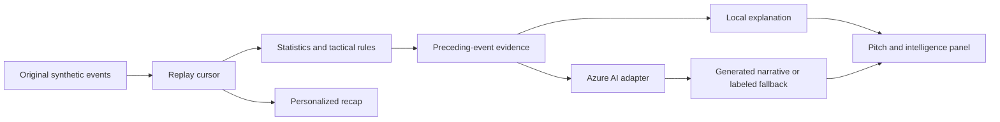

# Architecture

The client sends an index, not arbitrary facts. The server regenerates the match and uses only context at or before that index. Replay cancels stale requests and ignores late results.

Routes: `GET /`, `/app.js`, `/styles.css`, `/dataset.json`, `/api/health`; `POST /api/analyze` with index, mode, language and question. Health indicates configuration, not proven provider connectivity.

Progressive pass means a completed pass advancing at least 15 coordinate percentage points. A pressure cluster means at least two pressure events among the latest six actions. Shots do not produce invented xG. Coordinates are normalized toward the attacking goal; distance assumes a 105 × 68 m pitch.

Evidence chips list records supplied to the narrative service, not independent validation of every generated claim. Azure responses remain model interpretations. Review outputs and measure latency before recording the competition demo.

Deployable artifact: one Worker ES module with embedded assets. Local execution uses the Node HTTP adapter. Azure hosting is a future deployment step, not implemented here.

Automated checks cover deterministic/bounded events, temporal grounding, known statistics, audience differences, unsupported local questions, request validation, origins, local mode, mocked Azure success/outage and routes. Browser layout and click verification is pending because no browser backend was available.
